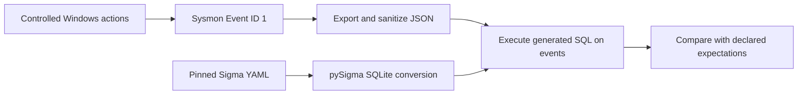

# Windows Detection Validation Lab


Three existing Sigma rules evaluated against six real
Windows Sysmon process events. All **nine expected results** passed.

The project asks whether selected rules recognize their intended command lines
and how an analyst should interpret matches from legitimate activity. It covers
account discovery and scheduled-task creation. No Sigma bug or upstream
contribution is claimed.

## Start here

| Document | What you can assess |
| --- | --- |
| [Final findings](FINDINGS.md) | Investigation, results, analyst conclusions, and limitations |
| [Whoami case study](cases/whoami-scope/README.md) | Two rules with different scopes and real comparison events |
| [Scheduled-task case study](cases/scheduled-task/README.md) | Creation detection, legitimate activity, and cleanup evidence |
| [Evidence reading guide](docs/READING-GUIDE.md) | Trace conclusions to exact captures, expectations, and queries |
| [Replay instructions](docs/REPRODUCIBILITY.md) | Reproduce the nine checks without building a VM |
| [Lab setup](docs/LAB-SETUP.md) | VM, logging, test activity, collection, and troubleshooting |

This project demonstrates evidence collection, detection validation, and
investigation reasoning. The original Sigma rules are by Florian Roth and
Nasreddine Bencherchali (Nextron Systems); see [attribution](NOTICE.md).

## Results at a glance

| Behavior | Rule(s) | Evidence | Outcome |
| --- | --- | --- | --- |
| Account/privilege discovery | whoami `/priv` and `/all` | Three Sysmon process events | Six expectations met |
| Scheduled-task creation | Creation via schtasks | Three Sysmon process events plus task query/deletion output | Three expectations met |

The tests intentionally use harmless actions. Matches demonstrate the configured
behavior, not malicious intent. A Sysmon process event records a command being
launched, not whether its intended action succeeded.



## Reproduce the measured results

Run on your laptop from the repository root with Python 3.11 or newer. A VM is
not required to replay the supplied captures. On Windows, Python 3.14 was used
for the recorded evaluation; exact library versions are in each result file.

```powershell
python -m venv .lab-env
.\.lab-env\Scripts\python.exe -m pip install -r requirements.txt
.\.lab-env\Scripts\python.exe evaluate_lab.py
```

Expected final line:

```text
Total: 9 expectations; all met: True
```

The last command returns a nonzero exit status if expectations fail. It regenerates
the case result JSON and SQL files, plus `results-summary.json`. The repeated
initial two-event experiment is not counted twice.

Run a single case with `--case scheduled-task`, `--case whoami-scope`, or
`--case whoami-priv`. The original `evaluate_whoami.py` commands remain available
as compatibility entry points.

The evaluator reads actual rule YAML using `SigmaCollection`, converts it with
`sqliteBackend`, and executes the generated queries in memory. No custom
implementation of the detection conditions is used. The supplied Sysmon fields
already match the rules, so no processing pipeline is applied. Log routing,
backend mappings, and SIEM alert delivery are outside this experiment.

## Case studies and files

- [Whoami rule scope comparison](cases/whoami-scope/README.md): `/priv`, `/all`,
  and the plain-command comparison; two rules and six checks.
- [Scheduled-task creation](cases/scheduled-task/README.md): creation, query,
  deletion, task outcome evidence, and three checks.
- `cases/whoami-priv/`: preserved first two-event baseline.
- `cases/*/events.sanitized.json` and `whoami-all.sanitized.json`: captured input.
- `cases/*/expected.json`: separately recorded expectations keyed by captured PID.
- `cases/*/results.json` and `*.sql`: measured outcomes and generated queries.
- `rules-manifest.json`: upstream commit, original paths, licenses, and rule hashes.
- `requirements.txt`: pinned direct dependencies.
- `environment-lock.txt`: full package snapshot from the executed environment.
- `export-whoami.ps1` and `export-scheduled-task.ps1`: read-only log collectors
  that save JSON inside the VM. Review the captures before using them as evidence.
- [Project status](PROJECT-STATUS.md): completion scope and verification.

## Repeat the live experiment

1. Use a Windows lab VM with Sysmon installed from
   [Microsoft](https://learn.microsoft.com/en-us/sysinternals/downloads/sysmon).
   This lab used default configuration: `Sysmon64.exe -i` from administrator
   PowerShell, with the license accepted. Sysmon records process creation with
   command lines. It does not evaluate Sigma rules.
2. Run `whoami`, followed by `whoami /priv`, and export the two events using
   `export-whoami.ps1`. Then run `whoami /all` and follow the scope case's export
   instructions.
3. Follow the scheduled-task case to create, query, and delete the uniquely named
   inert task. Keep command output as separate outcome evidence, then export the
   corresponding three Sysmon events.
4. Inspect every exported command line and event ID. Keep original captures
   privately and publish only documented sanitized copies.
5. A fresh capture has new PIDs/timestamps. Record its expectations separately;
   the bundled evaluator is intentionally pinned to the supplied capture IDs.

Event Viewer location: Applications and Services Logs > Microsoft > Windows >
Sysmon > Operational. Event ID 1 is process creation. An entry's `RuleName: -`
is Sysmon metadata, not a Sigma match result.

## Provenance and sanitization

All six records came from the user's live VM exports supplied through chat.
Original EVTX and Event XML are not included. The source channel is known from
the export command rather than a Channel field in the flattened JSON. Guest
timestamps are Sysmon-reported UTC and were not independently validated.

Only `User` and `ParentUser` were replaced in the JSON, with
`DESKTOP-LAB\LabUser`. Task output also substitutes HostName, Author, and Run As
User. Other supplied event fields are retained. The scheduled-task rule uses
the `User` field: both the original lab identity and the replacement fall outside
its `AUTHORI`/`AUTORI` exclusion patterns. A verification compared results using
the original identities in memory with results using the sanitized identities.

The VM was configured with 4 GB RAM, two vCPUs, an 80 GB growing SATA disk,
VMware Tools, and Sysmon 15.22. Windows Update was performed before capture.
The exact running guest OS build was not separately recorded; executable
file versions are not proof of the installed OS build.

## Limitations and contribution status

This small lab validates nine outcomes in one elevated Windows session. It does
not establish production false-positive rates, complete attack coverage, or
equivalence across SIEM backends. The scheduled-task exclusion branches and task
execution were not tested. See the findings for the full practical limits.

No upstream issue, pull request, or rule change is claimed by this project.
I generated and exported the VM activity. The rules and their authorship remain
attributed to SigmaHQ's contributors.

## Licensing and attribution

The three unchanged Sigma rules retain their UUIDs, authors, and references and
remain under the [Detection Rule License 1.1](LICENSES/DRL-1.1.md).
Their exact upstream paths and byte hashes are in `rules-manifest.json`, pinned
to [Sigma commit 05d1031](https://github.com/SigmaHQ/sigma/tree/05d1031f537e830b76da53bae2400c5814c89165).
The evaluator verifies those hashes before running the queries.

Whoami `/priv` and scheduled-task creation rules: Florian Roth (Nextron Systems).
Whoami `/all`: Florian Roth and Nasreddine Bencherchali (Nextron Systems).

Original project code and documentation are available under the [MIT license](LICENSE).

